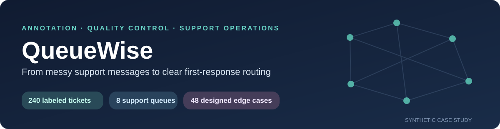
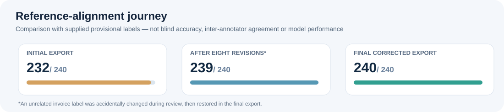
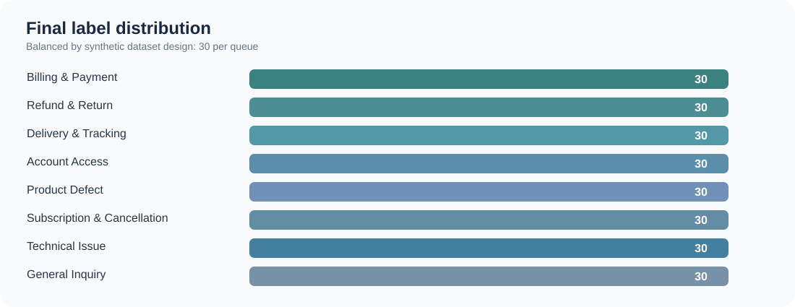

<p align="center">
  
</p>

<p align="center"><strong>Human-in-the-loop NLP annotation</strong> · <strong>Label Studio</strong> · <strong>Support operations</strong> · <strong>Annotation QA</strong></p>

> **The problem:** A customer mentions a broken tracking page but needs their shipment status. Another mentions a damaged product but explicitly requests a refund. If tickets are routed by surface keywords rather than **the action the customer needs**, they can go to the wrong team.
>
> **The deliverable:** A human-labeled, auditable 8-queue triage dataset, with hard-case explanations, a documented decision framework, revision history, and quality checks that a support-operations stakeholder can inspect.

**Portfolio status:** Completed annotation and reference-guided review · **Dataset:** Synthetic / educational · **Date:** 28 October 2026 · **Tool:** Label Studio · **No trained model or live deployment claimed**

## Project outcomes — what is actually evidenced

| Completed deliverable | Verified result | Interpretation |
|---|---:|---|
| Ticket annotation coverage | **240 / 240 (100%)** | Exactly one exported primary category per message |
| Routing taxonomy | **8 queues** | 30 reference cases per queue by design |
| Designed ambiguous / multi-intent examples | **48 / 240 (20%)** | Dataset designer's designation; not independently difficulty-tested |
| Final concordance with supplied provisional reference | **240 / 240** | **After reference-guided corrections**, not independent accuracy |
| Initial reference concordance | **232 / 240 (96.7%)** | Shows what required review before corrections |
| Greeting-variant consistency | **96 / 96 pairs** | Final single-annotator repeat consistency, not inter-annotator agreement |
| Unique texts after greeting normalization | **144** | Important limitation: repeated scenarios reduce diversity |

<p align="center"></p>

**Disclosure that matters:** The reference was consulted during review. Final 100% agreement therefore means **the final annotations conform to the supplied reference**, not that 240 independently validated decisions have been proved correct. No model accuracy, inter-annotator agreement, actual cost reduction, or shorter response times are inferred from this exercise.

## 01 / Business problem: why routing quality matters

A support manager needs incoming requests to reach the team able to take the **next actionable step**, not just whichever team matches a prominent keyword. In a real queue, misrouting can create extra transfers and delay case ownership. This is the operational risk this project models; the size of those effects was **not measured**.

| Risk in a keyword-based workflow | QueueWise decision | Evidence |
|---|---|---|
| “Defective” gets routed to product support even though the customer specifically wants a refund | **Refund & Return**, not Product Defect | [SUP-0010](docs/03_casebook.md#case-1-explicit-refund-beats-defect-symptom) |
| “Cancellation” triggers subscriptions when the user is locked out | **Account Access** first, because authentication blocks the desired action | [SUP-0017](docs/03_casebook.md#case-2-the-blocker-is-the-real-first-step) |
| “Delivery charge” is misread as a parcel problem | **Billing & Payment** for an incorrect invoice | [SUP-0054](docs/03_casebook.md#case-3-delivery-is-context-not-the-complaint) |
| A website error hides the customer's real request for shipment status | **Delivery & Tracking** for the requested status | [SUP-0182](docs/03_casebook.md#case-6-tracking-site-error-vs-request-for-status) |
| Subscription-pricing questions get conflated with cancellations | **General Inquiry** for pre-sale pricing information under the project taxonomy | [SUP-0233](docs/03_casebook.md#case-8-subscription-keywords-do-not-necessarily-mean-cancellation) |

**Desired business result (future validation):** better first-team routing and fewer avoidable transfers. This project establishes a labeling and QA foundation to *test* that result; it does not demonstrate it happened.

## 02 / Workflow and evidence

**Input messages** → **Primary-intent decision** → **One human label in Label Studio** → **CSV export** → **ID/text integrity checks** → **Provisional-reference comparison** → **Reference-guided revision** → **Operational casebook + proposed pilot**

<p align="center"><a href="assets/screenshots/03_completion_240_of_240.png"></a></p>
<p align="center"><sub>Original Label Studio workflow evidence, with the annotator's account identifier concealed where present.</sub></p>

### How a primary label is chosen

1. Identify the **action requested now**, including direct language such as “please process my approved refund.”
2. Distinguish **active incident / transaction** from **general information before purchase**.
3. If a requested outcome cannot proceed because of a **clear blocker**, route the blocker first when the customer explicitly asks to resolve it.
4. Separate a **broken digital feature** from an underlying delivery, billing, or account request.
5. Apply the business's documented **queue ownership policy** for genuinely borderline cases; do not treat the wording alone as universal truth.

The full [8-category routing guide](docs/02_routing_playbook.md) contains positive examples, exclusions, and policy-dependent exceptions.

## 03 / Hard cases: the decisions behind the numbers

These are screenshots of actual human annotation decisions, **not generated examples**. Each links to a deeper explanation of the competing queue and decisive wording.

| Refund vs defect | Account blocker vs cancellation |
|:---:|:---:|
| [](assets/screenshots/08_explicit_refund_vs_defect.png) | [](assets/screenshots/09_account_blocker_vs_cancel.png) |
| **SUP-0010 — Refund & Return**<br/>The customer asks for a refund, not troubleshooting. | **SUP-0017 — Account Access**<br/>The customer needs sign-in restored first. |

| Delivery reference vs invoice error | Tracking site error vs need for status |
|:---:|:---:|
| [](assets/screenshots/10_invoice_charge_vs_delivery.png) | [](assets/screenshots/13_tracking_status_vs_web_error.png) |
| **SUP-0054 — Billing & Payment**<br/>An extra delivery fee is an invoice dispute. | **SUP-0182 — Delivery & Tracking**<br/>The customer asks for shipment status. |

| Broken cancellation button | Shipping dashboard failure |
|:---:|:---:|
| [](assets/screenshots/12_unresponsive_cancel_button.png) | [](assets/screenshots/16_broken_shipping_dashboard.png) |
| **SUP-0150 — Technical Issue**<br/>A non-responsive control; ownership is **policy-dependent**. | **SUP-0239 — Technical Issue**<br/>The dashboard fails while tracking works. |

Other review-worthy examples: **[refund follow-up vs double billing](assets/screenshots/14_approved_refund_vs_double_billing.png)** · **[pre-purchase return policy](assets/screenshots/11_prepurchase_return_policy.png)** · **[nonprofit subscription pricing](assets/screenshots/15_nonprofit_subscription_pricing.png)** · **[warranty question without a defect](assets/screenshots/17_warranty_info_without_defect.png)**.

For **all ten carefully documented boundary examples**, see [03 / Edge-Case Decision Casebook](docs/03_casebook.md) and the [decision register CSV](reports/edge_case_decision_register.csv). Additional historical screenshots are available in [the evidence gallery](docs/04_screenshot_gallery.md).

## 04 / Quality assurance: from discrepancy to a stable final export

<p align="center"></p>

The evaluation was a **data-quality and reference-alignment audit**, not a deployed ML benchmark.

| Check | Observed result |
|---|---|
| Missing ticket IDs after joining task / export / reference | **0** |
| Duplicate task IDs or annotation IDs in final CSV | **0** |
| Source text mismatches | **0** |
| Invalid or absent exported labels | **0** |
| Original label vs provisional reference differences | **8** |
| Intermediate label vs reference differences | **1** (a temporary invoice relabel error) |
| Final label vs reference differences | **0** (after review) |
| Final inconsistent greeting variants | **0 / 96 pairs** |
| Filled confidence fields / review notes in Label Studio export | **0 / 240 each** (not collected) |

The original eight disagreements were resolved **with access to the supplied reference**. An accidental intermediate change to **SUP-0020** (billing dispute → general enquiry) was detected by comparing a near-duplicate ticket and corrected. This provides a real revision-control example: **preserve earlier labels, inspect changes, and use consistency checks to catch newly introduced errors**.

See [QA audit & validity limits](docs/05_quality_assurance.md) · [snapshot-level change history](reports/revision_history.csv) · [reference progress](reports/review_progress.csv) · [machine-readable audit summary](reports/qa_summary.json).

## 05 / What a support operations team can do with this

**A practical recommendation, not a claimed implementation:**

| Priority | Recommended action | Business owner | How success would be measured on live tickets |
|---|---|---|---|
| 1 | Approve explicit precedence rules for general pre-sales queries vs specialist queues | Support operations lead | Reduced category disagreements on blind QA sample |
| 2 | Specify escalation between Billing / Returns and Logistics / Technical | Support team leads | First-team routing accuracy; avoidable transfer rate |
| 3 | Require short justification + uncertainty flag on difficult tickets | QA lead | Reviewer agreement; escalation volume |
| 4 | Run a representative, independently reviewed real-ticket pilot | Operations + QA | Time-to-correct-team and rate of unnecessary reassignment |

**Decision-ready artifact:** [Operational Implementation Brief](docs/06_operations_recommendations.md).

## 06 / Explore the deliverables

| Start here | What it contains |
|---|---|
| [Business case](docs/01_business_context.md) | Stakeholder, support-triage failure mode, scope and business objective |
| [Routing playbook](docs/02_routing_playbook.md) | Eight categories, ownership, exclusions and tie-breaks |
| [Edge-case casebook](docs/03_casebook.md) | Ten grounded explanations with proof screenshots |
| [Screenshot gallery](docs/04_screenshot_gallery.md) | 17 curated proof screenshots indexed by task and theme |
| [Quality and limitations](docs/05_quality_assurance.md) | Baseline/final audit, duplicate-pair checks, and validity caveats |
| [Operations brief](docs/06_operations_recommendations.md) | Proposed rollout and success metrics |
| [Dataset dictionary](docs/07_data_dictionary.md) | Columns, source files, interpretation |
| [Provenance and ethics](docs/08_provenance.md) | Synthetic data, revisions, redaction, disclosure |
| [Final annotated CSV](data/processed/final_labeled_tickets.csv) | Task text, category, reference designation, routing metadata |
| [Revision history](reports/revision_history.csv) | Every label change across three timestamped exports |

### Reproduce the audit (optional)

You can inspect the CSVs in Excel or Google Sheets without writing code. The repository also provides a standard-library verification script for reviewers who prefer automated checks:

```bash
python scripts/verify_dataset.py
```

It confirms 240 unique aligned tasks, eight valid categories, all final reference matches, 48 designed boundary cases, and the 96 greeting-variant pairs.

### Where the approach stops

This is a **single-annotator, synthetic, partly duplicated, reference-guided learning project**. It is **not** customer production data; not a trained model; not a blind evaluation set; not measured inter-annotator agreement; and not evidence that customer-support costs or response times have already fallen. Some cases remain **organizational policy choices**, even when the final label matches the provisional reference.

---

**Portfolio focus:** NLP text annotation · Data quality · Primary-intent reasoning · Edge-case handling · Label Studio · Human-in-the-loop workflow · Operational reporting.

*Built to demonstrate disciplined human labeling and responsible QA, not to inflate metrics.*
