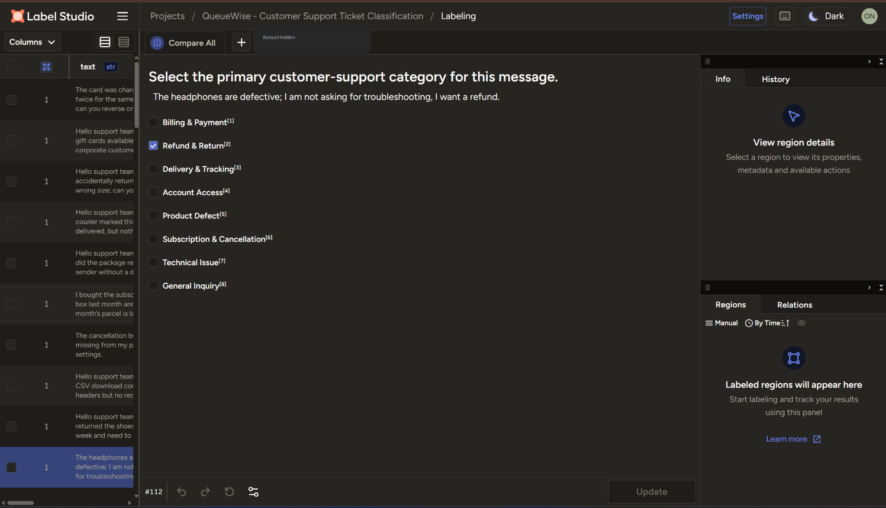
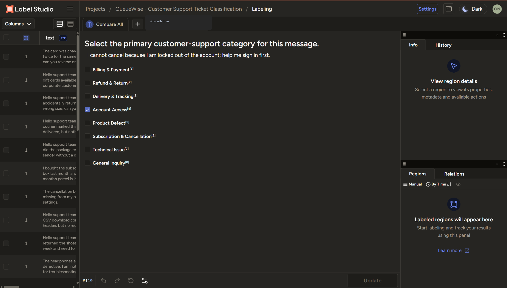
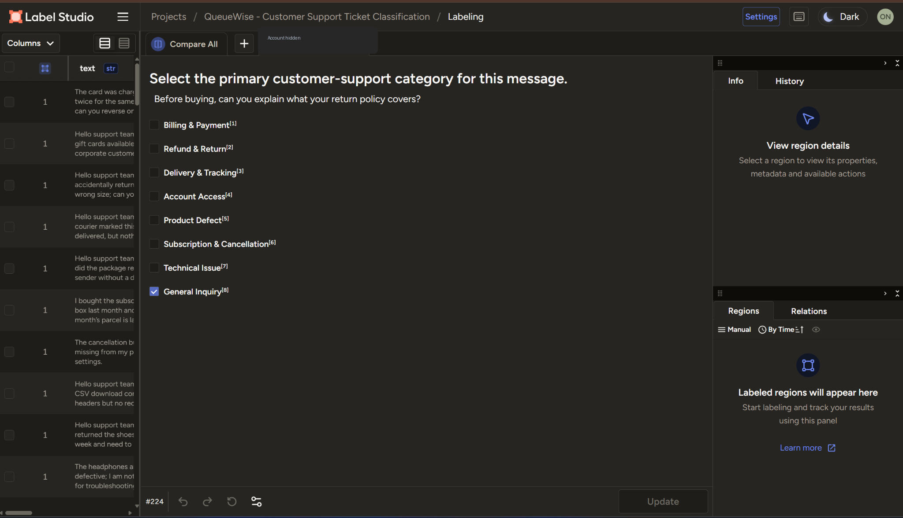
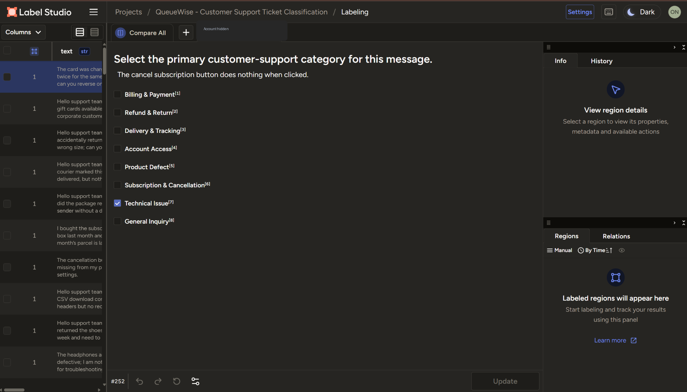
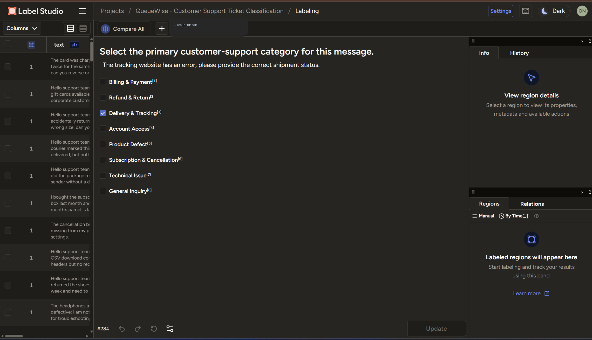
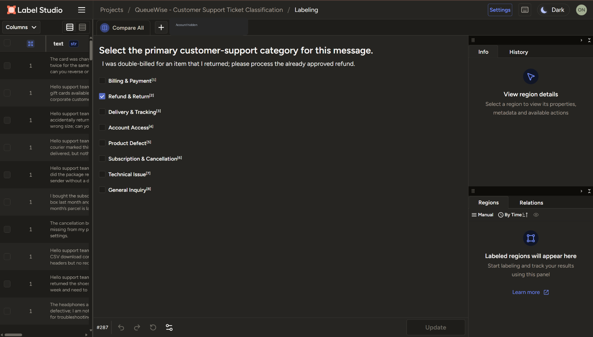
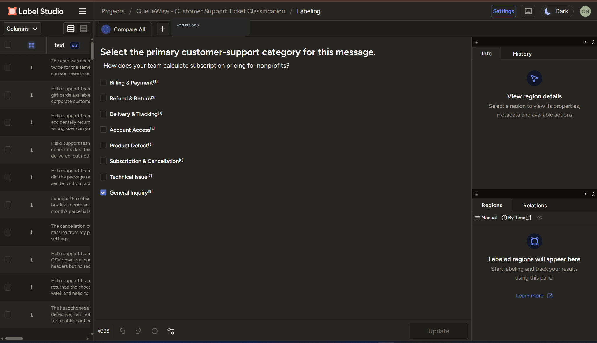
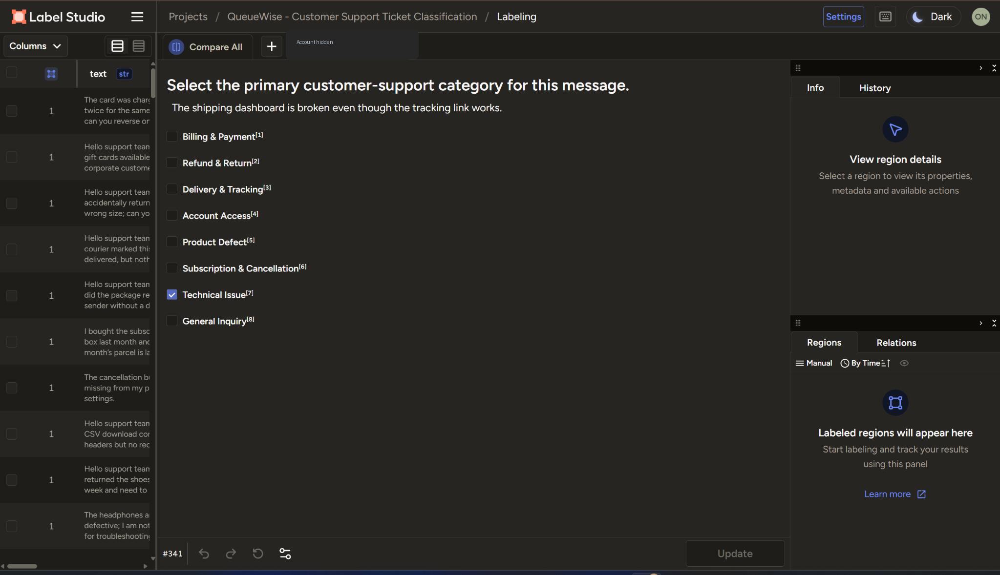
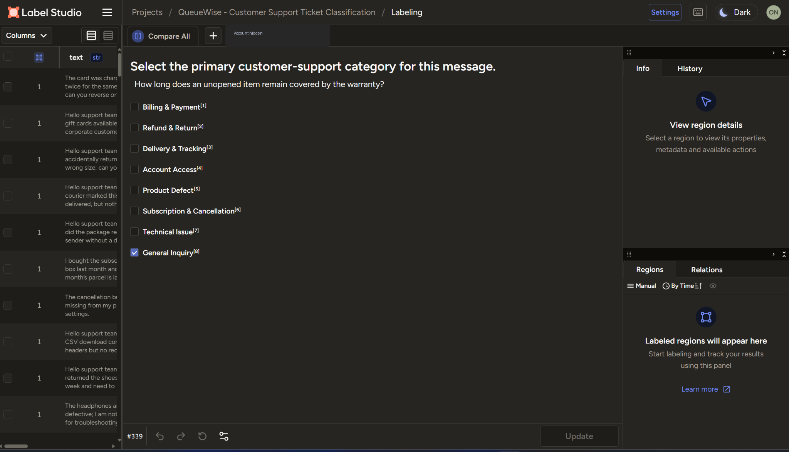

# 03 · Difficult-ticket decision casebook

> Actual dataset messages and Label Studio choices; analysis written after annotation. Labels match the supplied provisional reference, **not an independent blind gold standard**. Borderline organizational choices are explicitly marked.

## Case 1: Explicit refund beats defect symptom

**SUP-0010 · Label Studio record #112** · Dataset designation: Boundary / multi-intent

> The headphones are defective; I am not asking for troubleshooting, I want a refund.

- **Selected primary category:** Refund & Return
- **Competing category:** Product Defect
- **Decisive reason:** Explicit refund request overrides product-defect symptom.
- **Stakeholder-dependent ownership:** No explicit competing ownership rule required for this example.

## Case 2: The blocker is the real first step

**SUP-0017 · Label Studio record #119** · Dataset designation: Boundary / multi-intent

> I cannot cancel because I am locked out of the account; help me sign in first.

- **Selected primary category:** Account Access
- **Competing category:** Subscription & Cancellation
- **Decisive reason:** Immediate account-access blocker precedes cancellation request.
- **Stakeholder-dependent ownership:** No explicit competing ownership rule required for this example.

## Case 3: Delivery is context, not the complaint

**SUP-0054 · Label Studio record #156** · Dataset designation: Boundary / multi-intent

> I received the parcel, but the invoice contains an extra delivery charge. Please correct the invoice.

- **Selected primary category:** Billing & Payment
- **Competing category:** Delivery & Tracking
- **Decisive reason:** Extra delivery line is an invoice dispute, not a delivery incident.
- **Stakeholder-dependent ownership:** No explicit competing ownership rule required for this example.

## Case 4: A pre-purchase question about returns

**SUP-0122 · Label Studio record #224** · Dataset designation: Boundary / multi-intent

> Before buying, can you explain what your return policy covers?

- **Selected primary category:** General Inquiry
- **Competing category:** Refund & Return
- **Decisive reason:** Before-buying return-policy enquiry routed to general information under project rules.
- **Stakeholder-dependent ownership:** Yes — reference-consistent but other company rules are plausible.

## Case 5: Software failure inside a subscription workflow

**SUP-0150 · Label Studio record #252** · Dataset designation: Boundary / multi-intent

> The cancel subscription button does nothing when clicked.

- **Selected primary category:** Technical Issue
- **Competing category:** Subscription & Cancellation
- **Decisive reason:** Unresponsive cancellation control routed to technical team; policy-dependent.
- **Stakeholder-dependent ownership:** Yes — reference-consistent but other company rules are plausible.

## Case 6: Tracking site error vs request for status

**SUP-0182 · Label Studio record #284** · Dataset designation: Boundary / multi-intent

> The tracking website has an error; please provide the correct shipment status.

- **Selected primary category:** Delivery & Tracking
- **Competing category:** Technical Issue
- **Decisive reason:** Despite tracking site error, requested action is shipment-status confirmation.
- **Stakeholder-dependent ownership:** No explicit competing ownership rule required for this example.

## Case 7: Approved return refund vs double billing

**SUP-0185 · Label Studio record #287** · Dataset designation: Boundary / multi-intent

> I was double-billed for an item that I returned; please process the already approved refund.

- **Selected primary category:** Refund & Return
- **Competing category:** Billing & Payment
- **Decisive reason:** Already-approved return refund outweighs mention of double billing.
- **Stakeholder-dependent ownership:** No explicit competing ownership rule required for this example.

## Case 8: Subscription keywords do not necessarily mean cancellation

**SUP-0233 · Label Studio record #335** · Dataset designation: Boundary / multi-intent

> How does your team calculate subscription pricing for nonprofits?

- **Selected primary category:** General Inquiry
- **Competing category:** Subscription & Cancellation
- **Decisive reason:** General subscription pricing-policy enquiry; policy-dependent.
- **Stakeholder-dependent ownership:** Yes — reference-consistent but other company rules are plausible.

## Case 9: Broken dashboard vs functioning tracking link

**SUP-0239 · Label Studio record #341** · Dataset designation: Boundary / multi-intent

> The shipping dashboard is broken even though the tracking link works.

- **Selected primary category:** Technical Issue
- **Competing category:** Delivery & Tracking
- **Decisive reason:** Broken shipping dashboard is software malfunction; tracking link works.
- **Stakeholder-dependent ownership:** No explicit competing ownership rule required for this example.

## Case 10: Warranty information without an actual defect

**SUP-0237 · Label Studio record #339** · Dataset designation: Standard

> How long does an unopened item remain covered by the warranty?

- **Selected primary category:** General Inquiry
- **Competing category:** Product Defect
- **Decisive reason:** Warranty duration enquiry with no defect reported.
- **Stakeholder-dependent ownership:** No explicit competing ownership rule required for this example.

## Important complementary comparisons

| Boundary | Compare these cases | What changes? |
|---|---|---|
| Duplicate debit vs approved return refund | `SUP-0001` → Billing; `SUP-0185` → Returns | Transaction error vs follow-up on an approved refund |
| Request for status vs broken tracking dashboard | `SUP-0182` → Delivery; `SUP-0239` → Technical | Business information requested vs software feature repair |
| Broken button vs cancel request | `SUP-0150` → Technical; `SUP-0240` → Subscriptions | UI control failure vs a functioning subscription cancellation flow |
| Specific refund vs physical defect | `SUP-0010` → Refund; `SUP-0041` → Product Defect | Explicit financial remedy vs product malfunction report |
| Pre-sale return policy vs return eligibility | `SUP-0122` → General; `SUP-0090` → Returns | General future policy vs direct condition for initiating a return, **under project rubric** |

**Remember:** The casebook demonstrates how this synthetic exercise's reference categorization was interpreted. Under real operations, owners must sign off on ambiguous department boundaries.
