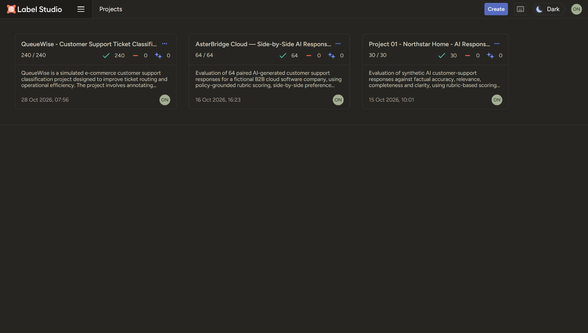
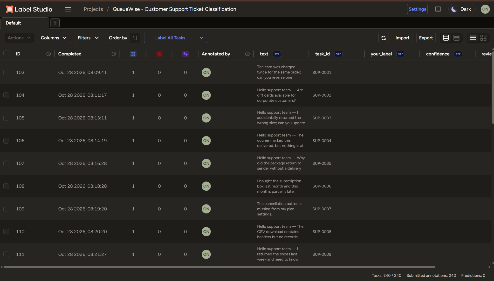
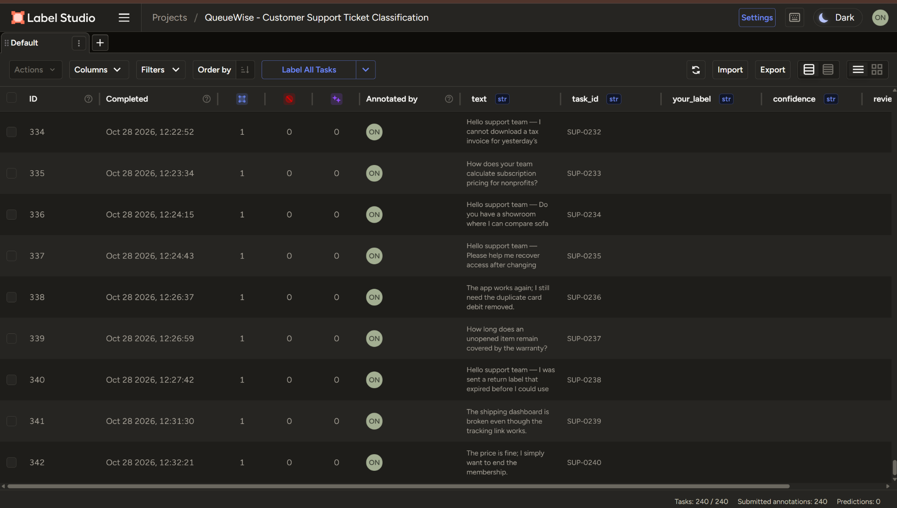
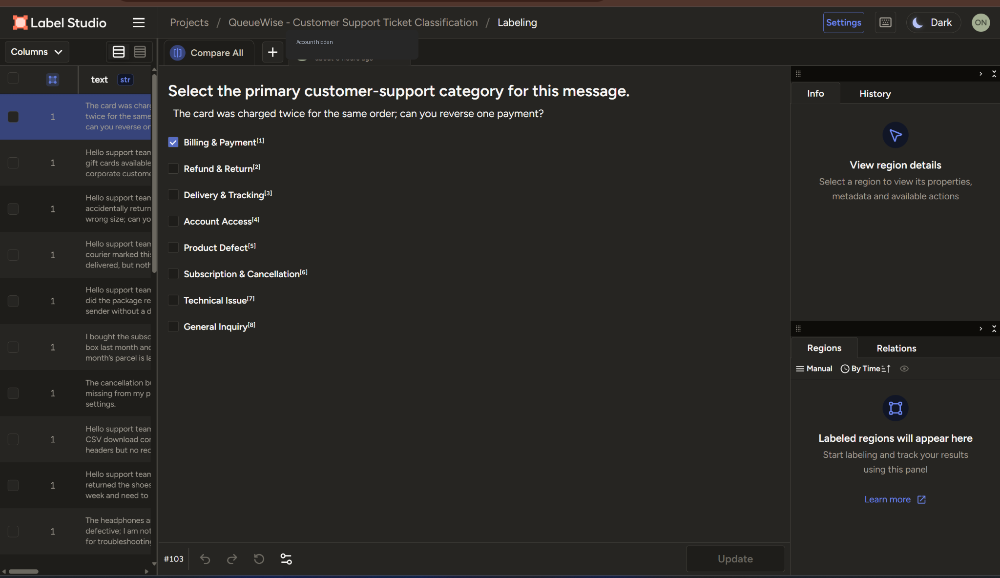
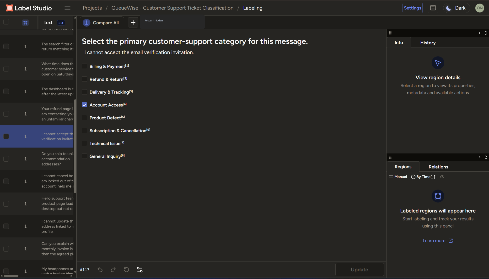
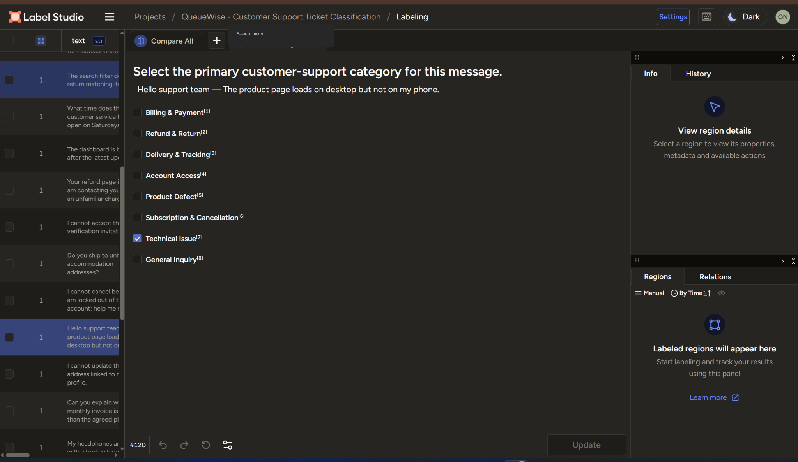
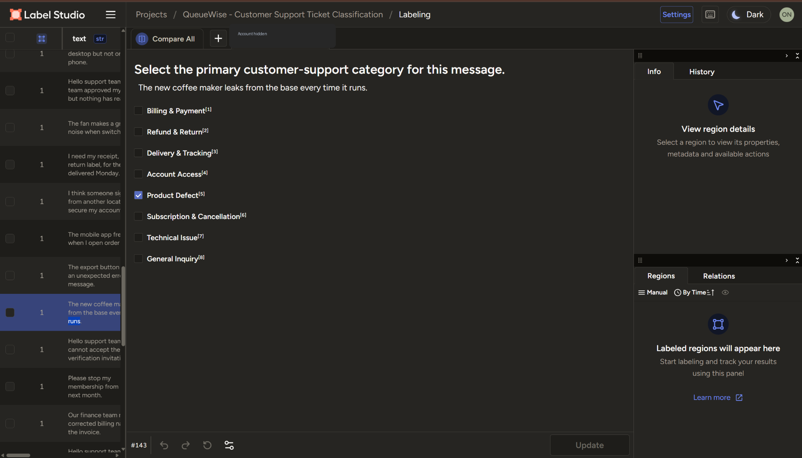

# 04 · Label Studio evidence gallery

**17 curated screenshots** from supplied screenshots. The account identifier area was concealed in labeling screenshots for portfolio privacy; ticket wording and selected categories were not changed. All case explanations are in [the decision casebook](03_casebook.md).

### 01. Workspace overview

### 02. Labeling data table

### 03. 240 of 240 completed

### 04. Duplicate debit → Billing & Payment

### 05. Email verification → Account Access

### 06. Mobile-only page failure → Technical Issue

### 07. Leaking coffee maker → Product Defect

### 08. Explicit refund overrides defect

### 09. Account blocker before cancellation

### 10. Invoice correction despite delivery context

### 11. Pre-purchase returns policy

### 12. Unresponsive cancellation button

### 13. Requested status despite website error

### 14. Approved refund despite double billing

### 15. General pricing inquiry

### 16. Broken dashboard vs tracking

### 17. Warranty coverage without reported defect

